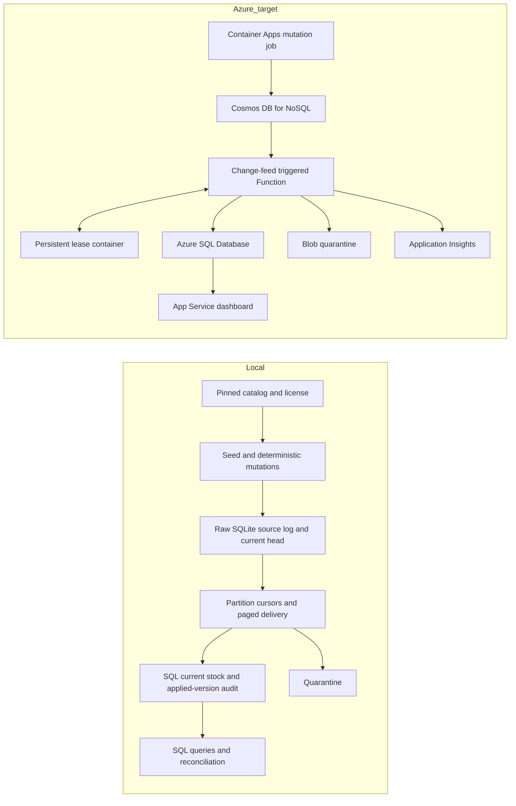

# Inventory Synchronization Without Full Reloads

How can a stock dashboard catch up after a consumer outage without loading the whole product catalog again? This project projects versioned product documents into SQL, retains soft deletes, and compares every recovered product with an independent fold of the input. The local drill runs without a subscription, containers or Python packages.

**Delivery stage.** The local implementation and its recorded checks use SQLite. **36 local tests passed**, including 11 Azure SDK adapter checks. Azure deployment, identity, cloud latency, recovery and actual costs remain unverified. [Validation record](docs/VALIDATION.md) · [Azure target and cleanup](docs/AZURE.md) · [Proposed AUD lab budget](docs/LAB_COST.md)

## Dataset and business problem

A retailer needs the latest stock for each product in each tenant. After an outage, late deliveries must preserve a product's newest quantity and a deleted product must stay off the active-stock report. A latest-version Cosmos DB feed can omit intermediate changes for the same item. A soft delete lets the consumer see the deletion as an update. A system that needs a complete movement ledger would require a different source contract. [Microsoft change feed modes](https://learn.microsoft.com/en-us/azure/cosmos-db/change-feed-modes)

The Cosmos DB Conf 2026 sample supplies 100 example products across three tenants. The adapter verifies a pinned MIT-licensed revision. The demo generates 900 variants with parent identifiers and 10,000 deterministic mutations. Stock changes, deletes, outages and event times are synthetic. Source access and file hashes were verified on 14 November 2026. [Source, field mapping and license](docs/SOURCE.md)

## Run it

Use Python 3.12+ with SQLite 3.31+ and a working HTTPS connection for the first public-source download. Run all commands from the repository root. The unit suite uses generated fixtures and local fakes.

```bash
python3 -W error::ResourceWarning -m unittest discover -s tests -v
# Make a new run directory each time. Existing evidence databases are preserved.
mkdir -p data
RUN_DIR=$(mktemp -d data/run.XXXXXX)
python3 inventory_demo.py drill --source-dir data/source --db "$RUN_DIR/drill.sqlite"
python3 inventory_demo.py time --source-dir data/source --db "$RUN_DIR/time.sqlite"
python3 inventory_demo.py export --source-dir data/source --output "$RUN_DIR/workload.jsonl"
python3 verify_projection.py "$RUN_DIR/drill.sqlite" "$RUN_DIR/workload.jsonl"
# Optional, with the SQLite CLI installed
sqlite3 -header -column "$RUN_DIR/drill.sqlite" < sql/local_reporting.sql
```

The first command after directory creation fetches about 1.6 MB. Subsequent runs verify and use the on-disk source cache. The export contains full JSON documents in submission order. Each command emits its report to standard output and progress to standard error.

## Architecture



| Component | Choice and rationale |
|---|---|
| Source acquisition | Python standard library verifies the exact commit's license and data, bounds response size and revalidates the cache. |
| Replay and SQL | SQLite WAL and explicit transactions allow the restart and redelivery tests to run on a laptop. Source inputs, checkpoints and applied versions remain queryable. |
| State contract | The key is the pair of tenant and product ID. Monotonic business versions distinguish a newer document, identical retry, stale write and conflicting version. |
| Deployment target | Azure Functions consumes the Cosmos change feed using durable leases. Azure SQL serves the stock projection. Bicep and Azure DevOps definitions describe the target environment. |
| Validation | Python unittest exercises offline fixtures. Separate public-source drills measure final-state agreement, simulated visibility and real local readback time. |

## Document and metric definitions

One normalized row is the full state of one product version.

| Field | Definition |
|---|---|
| `tenant_id`, `product_id` | Case-sensitive tenant and product identifiers in the local projection. Both identify a stock record. |
| `parent_id`, `sku` | The original sample product identifier and the row's stock-keeping unit. |
| `stock` | On-hand units as a nonnegative integer. Active-stock queries exclude deleted rows. |
| `version` | Positive integer per product. A conditional update preserves a newer item if an older delivery arrives. |
| `deleted` | Boolean soft-delete marker retained in the source and projection. |
| `changed_at_ms` | Virtual milliseconds from the beginning of the workload. Seed records start at zero. |

The two current-state views, immutable source payloads and hashes, projection audit, quarantine and checkpoint tables are documented in the [engine reference](docs/ENGINE.md). The [SQL report](sql/local_reporting.sql) returns active stock per tenant, visibility, outstanding deliveries and quarantine reasons.

The [Azure SQL observation query](sql/azure_observation.sql) reports elapsed time between Cosmos service timestamps and SQL procedure observations per tenant. Cosmos timestamps have one-second precision and the SQL observation precedes commit. A cloud acceptance run should also time external readback of committed rows.

**Visibility** uses the nearest-rank 95th percentile. The drill counts applied mutation versions and excludes initial seed rows and coalesced versions. It advances a synthetic clock and polls every 15 virtual seconds. A separate timing trial measures elapsed wall time from local submission to a matching SQL read on a second connection. It includes the cost of reading the full projection as a verification step. The Azure latency target is 60 seconds and still requires a deployed measurement.

## Sample results

The source-backed drill ended with **1,000 matching product states**, including **67 retained tombstones**. During a ten-minute simulated consumer outage the source accepted 600 mutations, including four soft deletes. On restart the projection caught up with zero mismatches. The simulated p95 was 14 seconds. **416 applied versions exceeded 60 seconds**, with a maximum simulated lag of 614 seconds. [Reproducible results and timing trial](docs/VALIDATION.md)

| Tenant | Active products | Stock units |
|---|---:|---:|
| outdoor-retail | 324 | 24,165 |
| ridge-supply | 304 | 26,080 |
| urban-expedition | 305 | 28,343 |

A separate **real ten-minute local outage** closed the consumer for 600.016 seconds while 600 producer transactions committed. After restart, all 1,000 product images matched, including four soft deletes made during that run. [Measured outage and replay commands](docs/WALL_OUTAGE.md)

## Recovery and operating limits

1. Inspect outstanding rows and quarantine reasons with the SQL report. A quarantine record points back to its immutable payload and SHA-256. Resolve conflicting writes upstream with a new business version.
2. To resume an interrupted consumer, reopen the same database with `inventory_sync.connect(path)` and call `inventory_sync.drain(db, visible_at_ms)` using a clock at or after all queued changes. State, applied-version audit and the page checkpoint commit together. The CLI demonstration intentionally requires a fresh destination and exercises this resume internally.
3. Keep tombstones available until every downstream consumer has recovered. Hard deletes and expired tombstones can disappear before a latest-version reader sees them. The local source log retains attempted deliveries for inspection. Real Cosmos latest-version mode cannot reconstruct every attempted update from that feed.
4. A local write lock serializes SQLite publication. A single host, a short synthetic outage and ten thousand mutations do not establish distributed recovery or capacity. The cloud runbook covers connector permissions, outages, reconciliation and teardown. [Azure target](docs/AZURE.md)

## Interview discussion

- Why compare complete documents as well as counts? A correct row count can hide stale quantities, tenant collisions and wrongly resurrected products.
- Why report exceptions above the target alongside p95? The global p95 stays at 14 simulated seconds even though hundreds of observations miss the 60-second target during recovery.
- What crosses a transaction boundary in Azure? SQL effects and Cosmos lease advancement use separate services. Conditional writes and stable quarantine identities must tolerate redelivery after a sink commit.

The original implementation uses the [MIT license](LICENSE). The input sample has its own [upstream MIT notice](third_party/CosmosConf26QueryDemos-LICENSE.txt).
